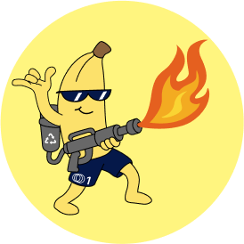
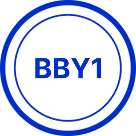
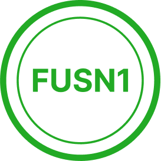

# UPDATED Bridging Map

### Infrastructure Layers

#### Supernet (e.g. Banana1 Supernet)

**Supernets** represent the top layer within a Layer-1 Multi-Chain Network. Each Supernet serves as a unified infrastructure layer that interconnects and manages multiple Layer-1 blockchains, providing seamless interoperability, shared security, and coordinated scalability across the entire network.

#### L1 Multi-Chain Network (e.g. Juneo Primary Network)

Each **Layer-1 Multi-Chain Network** operates independently, designed to address specific use cases or applications. These networks remain interconnected through shared infrastructure such as bridges, wallets, and explorers, as well as common governance. Together, they form a unified, scalable, and collaborative ecosystem within the Juneogo framework.

#### Blockchain/VM (e.g. JUNE-Chain)

At the heart of every Layer 1 is the **JUNE-Chain**, a blockchain powered by a custom virtual machine. This foundational layer manages the consensus, executes smart contracts, and validates transactions, forming the backbone of the network’s functionality.

***

### **Prefixes: m, k, w**

Some tokens have prefixes **m** (mili), **k** (kilo), **w** (wrapped).

Examples:

* mBTC
* kPEPE
* wJUNE

### **Native Tokens: 1**

Tokens with **1** in the end of their name represent versions of a native coin.

Examples:

* USD1
* SGD1
* EUR1

***

### **Bridge Ratio**

The **Bridging Ratio** defines the conversion rate between an existing ERC-20 token and its representation as a native coin on a new Layer 1 blockchain within the Juneo Supernet.\
\
For example:

* A **1:1** ratio means **1 ERC-20 token = 1 native coin**.
* A **1000:1** ratio means **1000 ERC-20 tokens = 1 native coin**.
* A **1:1000** ratio means **1 ERC-20 token = 1000 native coins**.

This ratio is defined at the time of deployment and applies across the bridging and unbridging processes to maintain a transparent and predictable asset relationship.

***

## Destination: JUNE-Chain

| Category               | Name              |
| ---------------------- | ----------------- |
| Supernet               | Juneo Supernet    |
| L1 Multi-Chain Network | Juneo Primary MCN |
| Blockchain / VM        | JUNE-Chain        |

<table><thead><tr><th width="83">Icon</th><th width="111">Symbol</th><th width="98">Token Source</th><th width="140">Source Chain</th><th width="208">Token Source Contract</th><th>Destination Chain</th></tr></thead><tbody><tr><td></td><td>USDT1</td><td>USDT</td><td>AVALANCHE</td><td>

0x9702...8c7

0x9702230A8Ea53601f5cD2dc00fDBc13d4dF4A8c7

</td><td><a href="https://juneoscan.io/chain/2/token/0x2d00000000000000000000000000000000000000">JUNE-Chain</a></td></tr><tr><td></td><td>USD1</td><td>USD</td><td>BINANCE</td><td>

0x8d0D...B0d

0x8d0D000Ee44948FC98c9B98A4FA4921476f08B0d

</td><td><a href="https://juneoscan.io/chain/2/token/0x2e00000000000000000000000000000000000000">JUNE-Chain</a></td></tr><tr><td></td><td>DAI1</td><td>DAI</td><td>BASE</td><td>

0x50c5...0Cb

0x50c5725949A6F0c72E6C4a641F24049A917DB0Cb

</td><td><a href="https://juneoscan.io/chain/2/token/0x2f00000000000000000000000000000000000000">JUNE-Chain</a></td></tr><tr><td></td><td>EUR1</td><td>EURO</td><td>BASE</td><td>

0x60a3...b42

0x60a3E35Cc302bFA44Cb288Bc5a4F316Fdb1adb42

</td><td><a href="https://juneoscan.io/chain/2/token/0x3000000000000000000000000000000000000000">JUNE-Chain</a></td></tr><tr><td></td><td>SGD1</td><td>XSGD</td><td>AVALANCHE</td><td>

0xb2F8...096E

0xb2F85b7AB3c2b6f62DF06dE6aE7D09c010a5096E

</td><td><a href="https://juneoscan.io/chain/2/token/0x3100000000000000000000000000000000000000">JUNE-Chain</a></td></tr><tr><td></td><td>GLD1</td><td>XAUt</td><td>ETHEREUM</td><td>

0x6874...238

0x68749665FF8D2d112Fa859AA293F07A622782F38

</td><td><a href="https://juneoscan.io/chain/2/token/0x3200000000000000000000000000000000000000">JUNE-Chain</a></td></tr><tr><td></td><td>mBTC1</td><td>BTC</td><td>AVALANCHE</td><td>

0x152b...350

0x152b9d0FdC40C096757F570A51E494bd4b943E50

</td><td><a href="https://juneoscan.io/chain/2/token/0x3300000000000000000000000000000000000000">JUNE-Chain</a></td></tr><tr><td></td><td>DOGE1</td><td>DOGE</td><td>BINANCE</td><td>

0xbA2a...443

0xbA2aE424d960c26247Dd6c32edC70B295c744C43

</td><td><a href="https://juneoscan.io/chain/2/token/0x3400000000000000000000000000000000000000">JUNE-Chain</a></td></tr><tr><td></td><td>LTC1</td><td>LTC</td><td>BINANCE</td><td>

0x4338...B94

0x4338665CBB7B2485A8855A139b75D5e34AB0DB94

</td><td><a href="https://juneoscan.io/chain/2/token/0x3500000000000000000000000000000000000000">JUNE-Chain</a></td></tr><tr><td></td><td>BCH1</td><td>BCH</td><td>BINANCE</td><td>

0x8fF7...4Df

0x8fF795a6F4D97E7887C79beA79aba5cc76444aDf

</td><td><a href="https://juneoscan.io/chain/2/token/0x3600000000000000000000000000000000000000">JUNE-Chain</a></td></tr><tr><td></td><td>LINK1</td><td>LINK</td><td>BINANCE</td><td>

0xF8A0...1bD

0xF8A0BF9cF54Bb92F17374d9e9A321E6a111a51bD

</td><td><a href="https://juneoscan.io/chain/2/token/0x3700000000000000000000000000000000000000">JUNE-Chain</a></td></tr><tr><td></td><td>BANA1</td><td>BANA1</td><td>JUNEO</td><td>

0xdcde...abd

0xdcde4f110039940265e34d188720ad8e4508dabd

</td><td><a href="https://juneoscan.io/chain/2/token/0xdcde4f110039940265e34d188720ad8e4508dabd">JUNE-Chain</a></td></tr><tr><td></td><td>BBY1</td><td>BBY1</td><td>JUNEO</td><td>

0x783e...44e

0x783e8fcea5045e9d4da420e233b46d77838d344e

</td><td><a href="https://juneoscan.io/chain/2/token/0x783e8fcea5045e9d4da420e233b46d77838d344e">JUNE-Chain</a></td></tr><tr><td></td><td>FUSN1</td><td>FUSN1</td><td>JUNEO</td><td>

0x48f3...073

0x48f37324eea586db8834753845633e3f90263073

</td><td><a href="https://juneoscan.io/chain/2/token/0x48f37324eea586db8834753845633e3f90263073">JUNE-Chain</a></td></tr></tbody></table>

***

**Users must never send funds directly to any Supernet Bridge Contract addresses.** \
\
The Supernet Bridge should only be used through its official UI, available [here](https://supernetbridge.io/). Funds sent directly to Supernet Bridge contract addresses will be permanently lost and cannot be recovered.

<table><thead><tr><th width="127">Token</th><th width="224">Bridge Contract</th><th width="92">Bridge Ratio</th><th>Cross-Chain</th><th>Layer 1</th></tr></thead><tbody><tr><td> USDT1</td><td>

0xe937...1C5

0xe937c6F9E586C8ff0a8f95A9338729241FC1D1C5

</td><td>1 : 1</td><td>Yes/No</td><td>Yes/NA</td></tr><tr><td> USD1</td><td>

0xa96D...286

0xa96Df7420cb98E31B71F27b16253e30E99834286

</td><td>1 : 1</td><td></td><td></td></tr><tr><td> DAI1</td><td>

0x0a55...8d2

0x0a5585b7484547C6f785dda99B33A323720578d2

</td><td>1 : 1</td><td></td><td></td></tr><tr><td> EUR1</td><td>

0x0a55...8d2

0x0a5585b7484547C6f785dda99B33A323720578d2

</td><td>1 : 1</td><td></td><td></td></tr><tr><td> SGD1</td><td>

0xe937...1C5

0xe937c6F9E586C8ff0a8f95A9338729241FC1D1C5

</td><td>1 : 1</td><td></td><td></td></tr><tr><td> GLD1</td><td>

0x8755...385

0x87555bFB823d107e9b03F22f9dF36a8f38Eb1385

</td><td>1 : 1</td><td></td><td></td></tr><tr><td> mBTC1</td><td>

0xe937...1C5

0xe937c6F9E586C8ff0a8f95A9338729241FC1D1C5

</td><td>1 : 1000</td><td></td><td></td></tr><tr><td> DOGE1</td><td>

0xa96D...286

0xa96Df7420cb98E31B71F27b16253e30E99834286

</td><td>1 : 1</td><td></td><td></td></tr><tr><td> LTC1</td><td>

0xa96D...286

0xa96Df7420cb98E31B71F27b16253e30E99834286

</td><td>1 : 1</td><td></td><td></td></tr><tr><td> BCH1</td><td>

0xa96D...286

0xa96Df7420cb98E31B71F27b16253e30E99834286

</td><td>1 : 1</td><td></td><td></td></tr><tr><td> LINK1</td><td>

0xa96D...286

0xa96Df7420cb98E31B71F27b16253e30E99834286

</td><td>1 : 1</td><td></td><td></td></tr><tr><td> BANA1</td><td>

0x945e...B3

0x945ee21F2704BD7Bf000B3350cdE8F63bdAD94B3

</td><td></td><td></td><td></td></tr><tr><td> BBY1</td><td>

0x3D16...C7

0x3D163FFA4ffA001fb52511a2661C70a5c23616C7

</td><td></td><td></td><td></td></tr><tr><td> FUSN1</td><td>

0x8B20...653c

0x8B20069Af083B2236f9f94213E91cAc00C99653c

</td><td></td><td></td><td></td></tr></tbody></table>

***

## Destination: BANANA1-Chain

| Category               | Name                |
| ---------------------- | ------------------- |
| Supernet               | Banana1 Supernet    |
| L1 Multi-Chain Network | Banana1 Primary MCN |
| Blockchain / VM        | BANANA1-Chain       |

<table><thead><tr><th width="92">Icon</th><th width="96">Symbol</th><th width="87">Token Source</th><th width="114">Source Chain</th><th width="212">Token Source Contract</th><th>Destination Chain</th></tr></thead><tbody><tr><td></td><td>USDC1</td><td>USDC</td><td>BASE</td><td>

0x8335...913

0x833589fCD6eDb6E08f4c7C32D4f71b54bdA02913

</td><td><a href="https://banana1.juneoscan.io/chain/2/token/0x3300000000000000000000000000000000000000">BANANA1-Chain</a></td></tr><tr><td></td><td>kBONK1</td><td>BONK</td><td>BINANCE</td><td>

0xA697...422

0xA697e272a73744b343528C3Bc4702F2565b2F422

</td><td><a href="https://banana1.juneoscan.io/chain/2/token/0x3200000000000000000000000000000000000000">BANANA1-Chain</a></td></tr><tr><td></td><td>KNC1</td><td>KNC</td><td>ARBITRUM</td><td>

0xe4DD...1bB

0xe4DDDfe67E7164b0FE14E218d80dC4C08eDC01cB

</td><td><a href="https://banana1.juneoscan.io/chain/2/token/0x3400000000000000000000000000000000000000">BANANA1-Chain</a></td></tr><tr><td></td><td>LUNA1</td><td>LUNA</td><td>BASE</td><td>

0x55cD...ee4

0x55cD6469F597452B5A7536e2CD98fDE4c1247ee4

</td><td><a href="https://banana1.juneoscan.io/chain/2/token/0x3500000000000000000000000000000000000000">BANANA1-Chain</a></td></tr><tr><td></td><td>SOL1</td><td>SOL</td><td>BINANCE</td><td>

0x570A...3dF

0x570A5D26f7765Ecb712C0924E4De545B89fD43dF

</td><td><a href="https://banana1.juneoscan.io/chain/2/token/0x2d00000000000000000000000000000000000000">BANANA1-Chain</a></td></tr><tr><td></td><td>TON1</td><td>TON</td><td>BINANCE</td><td>

0x76A7...20f

0x76A797A59Ba2C17726896976B7B3747BfD1d220f

</td><td><a href="https://banana1.juneoscan.io/chain/2/token/0x2f00000000000000000000000000000000000000">BANANA1-Chain</a></td></tr><tr><td></td><td>AIXBT1</td><td>AIXBT</td><td>BASE</td><td>

0x4F9F...825

0x4F9Fd6Be4a90f2620860d680c0d4d5Fb53d1A825

</td><td><a href="https://banana1.juneoscan.io/chain/2/token/0x3600000000000000000000000000000000000000">BANANA1-Chain</a></td></tr><tr><td></td><td>VIRTUAL1</td><td>VIRTUAL</td><td>BASE</td><td>

0x0b3e...1b

0x0b3e328455c4059EEb9e3f84b5543F74E24e7E1b

</td><td><a href="https://banana1.juneoscan.io/chain/2/token/0x3700000000000000000000000000000000000000">BANANA1-Chain</a></td></tr><tr><td></td><td>kPEPE1</td><td>PEPE</td><td>ARBITRUM</td><td>

0x25d8...00

0x25d887Ce7a35172C62FeBFD67a1856F20FaEbB00

</td><td><a href="https://banana1.juneoscan.io/chain/2/token/0x3000000000000000000000000000000000000000">BANANA1-Chain</a></td></tr><tr><td></td><td>kFLOKI1</td><td>FLOKI</td><td>BINANCE</td><td>

0xfb5B...7E

0xfb5B838b6cfEEdC2873aB27866079AC55363D37E

</td><td><a href="https://banana1.juneoscan.io/chain/2/token/0x3100000000000000000000000000000000000000">BANANA1-Chain</a></td></tr><tr><td></td><td>COOKIE1</td><td>COOKIE</td><td>BASE</td><td>

0xC004...5F

0xC0041EF357B183448B235a8Ea73Ce4E4eC8c265F

</td><td><a href="https://banana1.juneoscan.io/chain/2/token/0x2e00000000000000000000000000000000000000">BANANA1-Chain</a></td></tr></tbody></table>

***

**Users must never send funds directly to any Supernet Bridge contract addresses.** \
\
The Supernet Bridge should only be used through its official UI, available [here](https://supernetbridge.io/). Funds sent directly to Supernet Bridge contract addresses will be permanently lost and cannot be recovered.

<table><thead><tr><th width="138">Token</th><th width="225">Bridge Contract</th><th>Bridge Ratio</th><th>Cross-Chain</th><th>Layer 1</th></tr></thead><tbody><tr><td> USDC1</td><td>

0x4a97...11bd

0x4a9752A9a79192421cb90d1785e7A3D3a09611bd

</td><td>1 : 1</td><td></td><td></td></tr><tr><td> kBONK1</td><td>

0x9589...278

0x9589d6d76bc76202d380BbdF8a36B2bfFD702878

</td><td>1000 : 1</td><td></td><td></td></tr><tr><td> KNC1</td><td>

0xA778...da4

0xA77885ba96ac635CDDFf368264955952616edaA4

</td><td>1 : 1</td><td></td><td></td></tr><tr><td> LUNA1</td><td>

0x4a97...11bd

0x4a9752A9a79192421cb90d1785e7A3D3a09611bd

</td><td>1 : 1</td><td></td><td></td></tr><tr><td> SOL1</td><td>

0x9589...278

0x9589d6d76bc76202d380BbdF8a36B2bfFD702878

</td><td>1 : 1</td><td></td><td></td></tr><tr><td> TON1</td><td>

0x9589...278

0x9589d6d76bc76202d380BbdF8a36B2bfFD702878

</td><td>1 : 1</td><td></td><td></td></tr><tr><td> AIXBT1</td><td>

0x4a97...11bd

0x4a9752A9a79192421cb90d1785e7A3D3a09611bd

</td><td>1 : 1</td><td></td><td></td></tr><tr><td> VIRTUAL1</td><td>

0x4a97...11bd

0x4a9752A9a79192421cb90d1785e7A3D3a09611bd

</td><td>1 : 1</td><td></td><td></td></tr><tr><td> kPEPE1</td><td>

0xA778...da4

0xA77885ba96ac635CDDFf368264955952616edaA4

</td><td>1000 : 1</td><td></td><td></td></tr><tr><td> kFLOKI1</td><td>

0x9589...278

0x9589d6d76bc76202d380BbdF8a36B2bfFD702878

</td><td>1000 : 1</td><td></td><td></td></tr><tr><td> COOKIE1</td><td>

0x4a97...11bd

0x4a9752A9a79192421cb90d1785e7A3D3a09611bd

</td><td>1 : 1</td><td></td><td></td></tr></tbody></table>

***

## Destination: BLUEBYTE1-Chain

| Category               | Name                  |
| ---------------------- | --------------------- |
| Supernet               | Bluebyte1 Supernet    |
| L1 Multi-Chain Network | Bluebyte1 Primary MCN |
| Blockchain / VM        | BLUEBYTE1-Chain       |

<table><thead><tr><th width="79">Icon</th><th width="98">Symbol</th><th width="101">Token Source</th><th width="122">Source Chain</th><th width="203">Token Source Contract</th><th>Destination Chain</th></tr></thead><tbody><tr><td></td><td>PYUSD1</td><td>PYUSD</td><td>ARBITRUM</td><td>

0x4685...984

0x46850aD61C2B7d64d08c9C754F45254596696984

</td><td><a href="https://bluebyte1.juneoscan.io/chain/2/token/0x2d00000000000000000000000000000000000000">BLUEBYTE1-Chain</a></td></tr><tr><td></td><td>LCX1</td><td>LCX</td><td>ETHEREUM</td><td>

0x037A...e41

0x037A54AaB062628C9Bbae1FDB1583c195585fe41

</td><td><a href="https://bluebyte1.juneoscan.io/chain/2/token/0x2e00000000000000000000000000000000000000">BLUEBYTE1-Chain</a></td></tr><tr><td></td><td>NEXO1</td><td>NEXO</td><td>POLYGON</td><td>

0x41b3...48E

0x41b3966B4FF7b427969ddf5da3627d6AEAE9a48E

</td><td><a href="https://bluebyte1.juneoscan.io/chain/2/token/0x2f00000000000000000000000000000000000000">BLUEBYTE1-Chain</a></td></tr><tr><td></td><td>BORG1</td><td>BORG</td><td>ETHEREUM</td><td>

0x64d0...224

0x64d0f55Cd8C7133a9D7102b13987235F486F2224

</td><td><a href="https://bluebyte1.juneoscan.io/chain/2/token/0x3000000000000000000000000000000000000000">BLUEBYTE1-Chain</a></td></tr><tr><td></td><td>ETC1</td><td>ETC</td><td>BINANCE</td><td>

0x46a5...431

0x46a531fE4BF0728b00A5ce09291091E630E83431

</td><td><a href="https://bluebyte1.juneoscan.io/chain/2/token/0x3100000000000000000000000000000000000000">BLUEBYTE1-Chain</a></td></tr><tr><td></td><td>wstETH1</td><td>wsETH</td><td>BASE</td><td>

0xc1CB...452

0xc1CBa3fCea344f92D9239c08C0568f6F2F0ee452

</td><td><a href="https://bluebyte1.juneoscan.io/chain/2/token/0x3200000000000000000000000000000000000000">BLUEBYTE1-Chain</a></td></tr><tr><td></td><td>XLM1</td><td>XLM</td><td>BINANCE</td><td>

0x43C9...1B9

0x43C934A845205F0b514417d757d7235B8f53f1B9

</td><td><a href="https://bluebyte1.juneoscan.io/chain/2/token/0x3300000000000000000000000000000000000000">BLUEBYTE1-Chain</a></td></tr><tr><td></td><td>BNT1</td><td>BNT</td><td>ETHEREUM</td><td>

0x1F57...F1C

0x1F573D6Fb3F13d689FF844B4cE37794d79a7FF1C

</td><td><a href="https://bluebyte1.juneoscan.io/chain/2/token/0x3400000000000000000000000000000000000000">BLUEBYTE1-Chain</a></td></tr><tr><td></td><td>BAT1</td><td>BAT</td><td>BINANCE</td><td>

0x31C7...661

0x31C78f583ed0288D67b2b80Dc5C443Bc3b15C661

</td><td><a href="https://bluebyte1.juneoscan.io/chain/2/token/0x3500000000000000000000000000000000000000">BLUEBYTE1-Chain</a></td></tr><tr><td></td><td>C98</td><td>C98</td><td>BINANCE</td><td>

0xaEC9...3a6

0xaEC945e04baF28b135Fa7c640f624f8D90F1C3a6

</td><td><a href="https://bluebyte1.juneoscan.io/chain/2/token/0x3600000000000000000000000000000000000000">BLUEBYTE1-Chain</a></td></tr><tr><td></td><td>PYTH1</td><td>PYTH</td><td>ARBITRUM</td><td>

0xE4D5...724

0xE4D5c6aE46ADFAF04313081e8C0052A30b6Dd724

</td><td><a href="https://bluebyte1.juneoscan.io/chain/2/token/0x3700000000000000000000000000000000000000">BLUEBYTE1-Chain</a></td></tr></tbody></table>

***

**Users must never send funds directly to any Supernet Bridge contract addresses.** \
\
The Supernet Bridge should only be used through its official UI, available [here](https://supernetbridge.io/). Funds sent directly to Supernet Bridge contract addresses will be permanently lost and cannot be recovered.

<table><thead><tr><th width="122">Token</th><th width="238">Bridge Contract</th><th>Bridge Ratio</th><th>Cross-Chain</th><th>Layer 1</th></tr></thead><tbody><tr><td> PYUSD1</td><td>

0xA778...da4

0xA77885ba96ac635CDDFf368264955952616edaA4

</td><td>1 : 1</td><td></td><td></td></tr><tr><td> LCX1</td><td>

0xbfCA...30c

0xbfCAc46F48C5f6F4B784c8676F1877681f1e330c

</td><td>1 : 1</td><td></td><td></td></tr><tr><td> NEXO1</td><td>

0x214D...f95

0x214D6c109bB789B02C976BE7dE0f90320c946f95

</td><td>1 : 1</td><td></td><td></td></tr><tr><td> BORG1</td><td>

0xbfCA...30c

0xbfCAc46F48C5f6F4B784c8676F1877681f1e330c

</td><td>1 : 1</td><td></td><td></td></tr><tr><td> ETC1</td><td>

0x9589...278

0x9589d6d76bc76202d380BbdF8a36B2bfFD702878

</td><td>1 : 1</td><td></td><td></td></tr><tr><td> wstETH1</td><td>

0x4a97...11bd

0x4a9752A9a79192421cb90d1785e7A3D3a09611bd

</td><td>1 : 1</td><td></td><td></td></tr><tr><td> XLM1</td><td>

0x9589...278

0x9589d6d76bc76202d380BbdF8a36B2bfFD702878

</td><td>1 : 1</td><td></td><td></td></tr><tr><td> BNT1</td><td>

0xbfCA...30c

0xbfCAc46F48C5f6F4B784c8676F1877681f1e330c

</td><td>1 : 1</td><td></td><td></td></tr><tr><td> BAT1</td><td>

0x9589...278

0x9589d6d76bc76202d380BbdF8a36B2bfFD702878

</td><td>1 : 1</td><td></td><td></td></tr><tr><td> C98</td><td>

0x9589...278

0x9589d6d76bc76202d380BbdF8a36B2bfFD702878

</td><td>1 : 1</td><td></td><td></td></tr><tr><td> PYTH1</td><td>

0xA778...da4

0xA77885ba96ac635CDDFf368264955952616edaA4

</td><td>1 : 1</td><td></td><td></td></tr></tbody></table>

***

## Destination: FUSION1-Chain

| Category               | Name                |
| ---------------------- | ------------------- |
| Supernet               | Fusion1 Supernet    |
| L1 Multi-Chain Network | Fusion1 Primary MCN |
| Blockchain / VM        | FUSION1-Chain       |

<table><thead><tr><th width="92">Icon</th><th>Symbol</th><th>Token Source</th><th width="133">Source Chain</th><th width="212">Token Source Contract</th><th>Destination Chain</th></tr></thead><tbody><tr><td></td><td>SANTOS1</td><td>SANTOS</td><td>BINANCE</td><td>

0xA644...Cc7

0xA64455a4553C9034236734FadDAddbb64aCE4Cc7

</td><td><a href="https://fusion1.juneoscan.io/chain/2/token/0x2d00000000000000000000000000000000000000">FUSION1-Chain</a></td></tr><tr><td></td><td>PSG1</td><td>PSG</td><td>CHILIZ</td><td>

0xc266...105

0xc2661815c69c2b3924d3dd0c2c1358a1e38a3105

</td><td><a href="https://fusion1.juneoscan.io/chain/2/token/0x2e00000000000000000000000000000000000000">FUSION1-Chain</a></td></tr><tr><td></td><td>JUV1</td><td>JUV</td><td>CHILIZ</td><td>

0x4540...6d0

0x454038003a93cf44766af352f74bad6b745616d0

</td><td><a href="https://fusion1.juneoscan.io/chain/2/token/0x2f00000000000000000000000000000000000000">FUSION1-Chain</a></td></tr><tr><td></td><td>GAL1</td><td>GAL</td><td>CHILIZ</td><td>

0x6dab...e0d

0x6dab8fe8e5d425f2eb063aae58540aa04e273e0d

</td><td><a href="https://fusion1.juneoscan.io/chain/2/token/0x3000000000000000000000000000000000000000">FUSION1-Chain</a></td></tr><tr><td></td><td>OG1</td><td>OG</td><td>CHILIZ</td><td>

0x19ca...294

0x19ca0f4adb29e2130a56b9c9422150b5dc07f294

</td><td><a href="https://fusion1.juneoscan.io/chain/2/token/0x3100000000000000000000000000000000000000">FUSION1-Chain</a></td></tr><tr><td></td><td>FORM1</td><td>FORM</td><td>BINANCE</td><td>

0x5b73...284

0x5b73A93b4E5e4f1FD27D8b3F8C97D69908b5E284

</td><td><a href="https://fusion1.juneoscan.io/chain/2/token/0x3200000000000000000000000000000000000000">FUSION1-Chain</a></td></tr><tr><td></td><td>SAND1</td><td>SAND</td><td>POLYGON</td><td>

0xBbba...683

0xBbba073C31bF03b8ACf7c28EF0738DeCF3695683

</td><td><a href="https://fusion1.juneoscan.io/chain/2/token/0x3300000000000000000000000000000000000000">FUSION1-Chain</a></td></tr><tr><td></td><td>AED1</td><td>DRAM</td><td>ARBITRUM</td><td>----</td><td><a href="https://fusion1.juneoscan.io/chain/2/token/0x3500000000000000000000000000000000000000">FUSION1-Chain</a></td></tr><tr><td></td><td>vUSD1</td><td>vUSD</td><td>JUNEO</td><td>----</td><td><a href="https://fusion1.juneoscan.io/chain/2/token/0x3600000000000000000000000000000000000000">FUSION1-Chain</a></td></tr><tr><td></td><td>MXN1</td><td>MXN</td><td>ETHEREUM</td><td>----</td><td><a href="https://fusion1.juneoscan.io/chain/2/token/0x3700000000000000000000000000000000000000">FUSION1-Chain</a></td></tr><tr><td></td><td>BRL1</td><td>BRL</td><td>BINANCE</td><td>----</td><td><a href="https://fusion1.juneoscan.io/chain/2/token/0x3400000000000000000000000000000000000000">FUSION1-Chain</a></td></tr></tbody></table>

***

**Users must never send funds directly to any Supernet Bridge contract addresses.** \
\
The Supernet Bridge should only be used through its official UI, available [here](https://supernetbridge.io/). Funds sent directly to Supernet Bridge contract addresses will be permanently lost and cannot be recovered.

<table><thead><tr><th>Token</th><th width="275">Bridge Contract</th><th>Bridge Ratio</th><th>Cross-Chain</th><th>Layer 1</th></tr></thead><tbody><tr><td> SANTOS1</td><td>

0x9589...278

0x9589d6d76bc76202d380BbdF8a36B2bfFD702878

</td><td>1 : 1</td><td></td><td></td></tr><tr><td> PSG1</td><td>

0x4846...dea4

0x4846AdcC6a0bA5a451f853A673805c92b4B6dea4

</td><td>1 : 1</td><td></td><td></td></tr><tr><td> JUV1</td><td>

0x4846...dea4

0x4846AdcC6a0bA5a451f853A673805c92b4B6dea4

</td><td>1 : 1</td><td></td><td></td></tr><tr><td> GAL1</td><td>

0x4846...dea4

0x4846AdcC6a0bA5a451f853A673805c92b4B6dea4

</td><td>1 : 1</td><td></td><td></td></tr><tr><td> OG1</td><td>

0x4846...dea4

0x4846AdcC6a0bA5a451f853A673805c92b4B6dea4

</td><td>1 : 1</td><td></td><td></td></tr><tr><td> FORM1</td><td>

0x9589...278

0x9589d6d76bc76202d380BbdF8a36B2bfFD702878

</td><td>1 : 1</td><td></td><td></td></tr><tr><td> SAND1</td><td>

0x214D...f95

0x214D6c109bB789B02C976BE7dE0f90320c946f95

</td><td>1 : 1</td><td></td><td></td></tr><tr><td> AED1</td><td>----</td><td>1 : 1</td><td></td><td></td></tr><tr><td> vUSD1</td><td>----</td><td>1 : 1</td><td></td><td></td></tr><tr><td> MXN1</td><td>----</td><td>1 : 1</td><td></td><td></td></tr><tr><td> BRL1</td><td>----</td><td>1 : 1</td><td></td><td></td></tr></tbody></table>

***

The **Supernet Bridge** should only be used through its official UI, available [**here**](https://supernetbridge.io/)**.**
